# Café Desk 桌上咖啡吧

**繁體中文** ｜ [English](#english)

放在桌面上的咖啡機擺件。視窗裡站著咖啡機、磨豆機和各種器具（預設是一般視窗；右鍵取消「視窗化顯示」就變成透明無邊框、直接站在桌面上），點一下就用動畫和合成音效做一杯咖啡，最後給一個簡單的分數。

- 五種沖煮方式，各有自己的畫面：義式咖啡機、手沖、冰滴、摩卡壺、虹吸壺（冰滴約 1 小時，依架好時記下的時間計算；關掉程式時不會執行，重開時依經過的時間算出進度）
- 五台咖啡機（DESK·01 雙錶不鏽鋼機、復古拉桿機、小型單鍋爐機、內建磨豆的一體機、兩個沖煮頭的營業用雙頭機），各有特性影響萃取
- 濃縮、美式、拿鐵、卡布奇諾、馥列白、摩卡、焦糖瑪奇朵、濃縮通寧、阿芙佳朵等 16 種義式飲品，加上手沖、冰滴、摩卡壺、虹吸；節日期間另有 3 款季節限定
- 完整備粉流程（取把手 → 敲渣 → 磨豆 → 布粉 → 填壓 → 扣回）、打奶與拉花、豆子與養豆天數、清潔保養（每台咖啡機分開計算）
- 三種模式：手動、自動（照目前的設定重複沖煮）、營業（客人點單付錢、排隊、有耐心，做好後在櫃檯取餐才評分）
- 營業模式：出杯台與櫃檯店面、POS 結帳、內用／外帶、大中小杯、一張單好幾杯、座位、翻頁鐘
- 營業模式的成長：店鋪等級 Lv.1–10、咖啡師稱號（職人可以萃取的同時打奶）、打烊日報；用營業額在商店買設備升級與精品豆，設備與飲品依等級解鎖
- 陪伴功能：環境音（下雨天的咖啡廳、森林雨聲與遠雷）、播放自己的音樂、休息提醒、每天自動檢查新版本
- 簡化的物理：倒的時候液面保持水平、越倒越空傾斜得越多，容器從杯子上方繞過；手沖的水珠受重力加速、細水柱斷成水滴
- 紀錄與收集冊：每日紀錄、61 個成就（分級的有銅／銀／金，只算為客人做的杯子）、飲品與設備圖鑑（含拉花收集）、遊戲說明
- 16:9 視窗（1920×1080、1600×900、1280×720、960×540）；紙張風格的選單與視窗；繁體中文／English（金額跟著語言顯示新台幣或美金）

<p align="center">
  
</p>

## 畫面

### 一杯拿鐵的過程

<table width="100%">
  <tr>
    <td width="33%" align="center" valign="top"><br><b>萃取</b><br>咖啡液流進杯中，磅秤顯示重量與時間</td>
    <td width="33%" align="center" valign="top"><br><b>打奶</b><br>蒸汽管打奶，溫度與奶泡量影響拉花</td>
    <td width="33%" align="center" valign="top"><br><b>拉花</b><br>傾倒牛奶，拉花卡片即時顯示圖案</td>
  </tr>
</table>

做完後狀態列給星等、分數與評語；滑鼠停在機身上會顯示萃取曲線與拉花卡片。

### 四台咖啡機

<table width="100%">
  <tr>
    <td width="50%" align="center" valign="top"><br><b>DESK·01 雙錶不鏽鋼機</b></td>
    <td width="50%" align="center" valign="top"><br><b>復古拉桿機</b></td>
  </tr>
  <tr>
    <td width="50%" align="center" valign="top"><br><b>小型單鍋爐機</b></td>
    <td width="50%" align="center" valign="top"><br><b>內建磨豆的一體機</b></td>
  </tr>
</table>

### 手沖與冰滴

<table width="100%">
  <tr>
    <td width="33%" align="center" valign="top">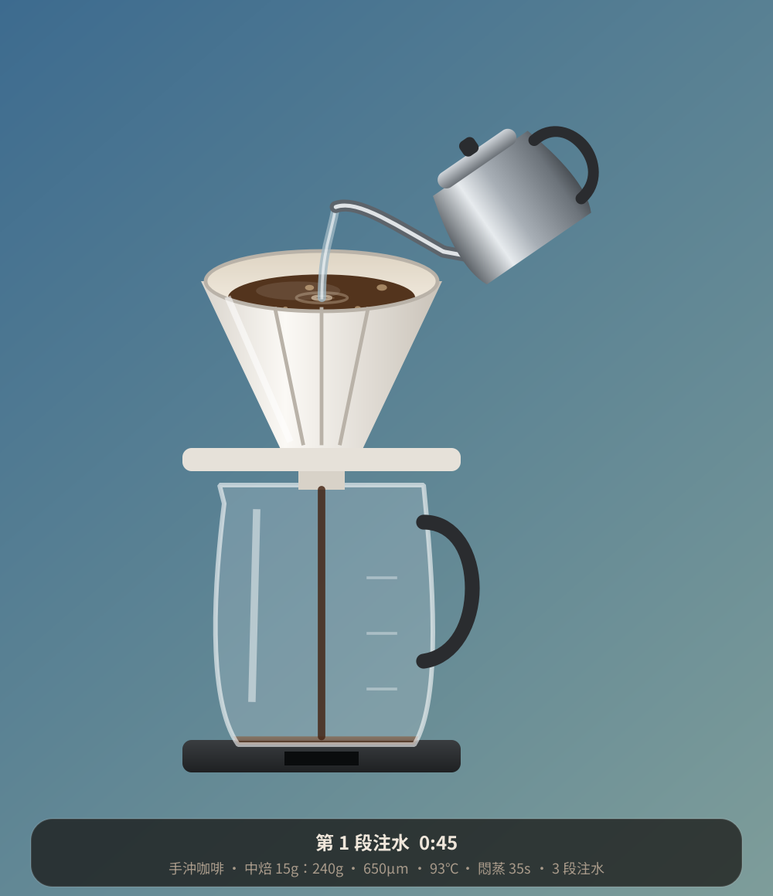<br><b>手沖</b><br>沖煮時畫面拉近：悶蒸、分段繞圈注水、滴濾</td>
    <td width="33%" align="center" valign="top"><br><b>倒進杯子</b><br>沖完拉遠，分享壺倒進杯子；左邊是手沖用磨豆機</td>
    <td width="33%" align="center" valign="top">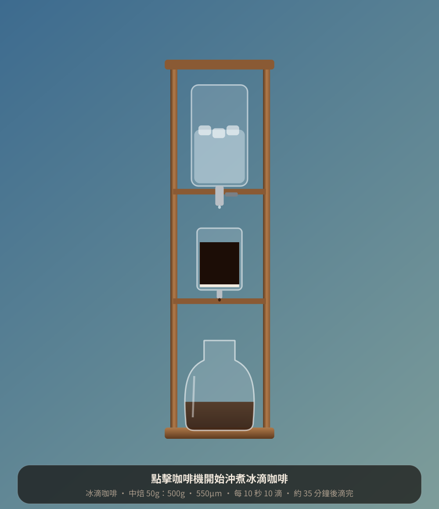<br><b>冰滴</b><br>依實際經過的時間滴約 1 小時（關掉程式時間也照算），滴完可以做 4 杯</td>
  </tr>
</table>

### 摩卡壺與虹吸壺

<table width="100%">
  <tr>
    <td width="33%" align="center" valign="top">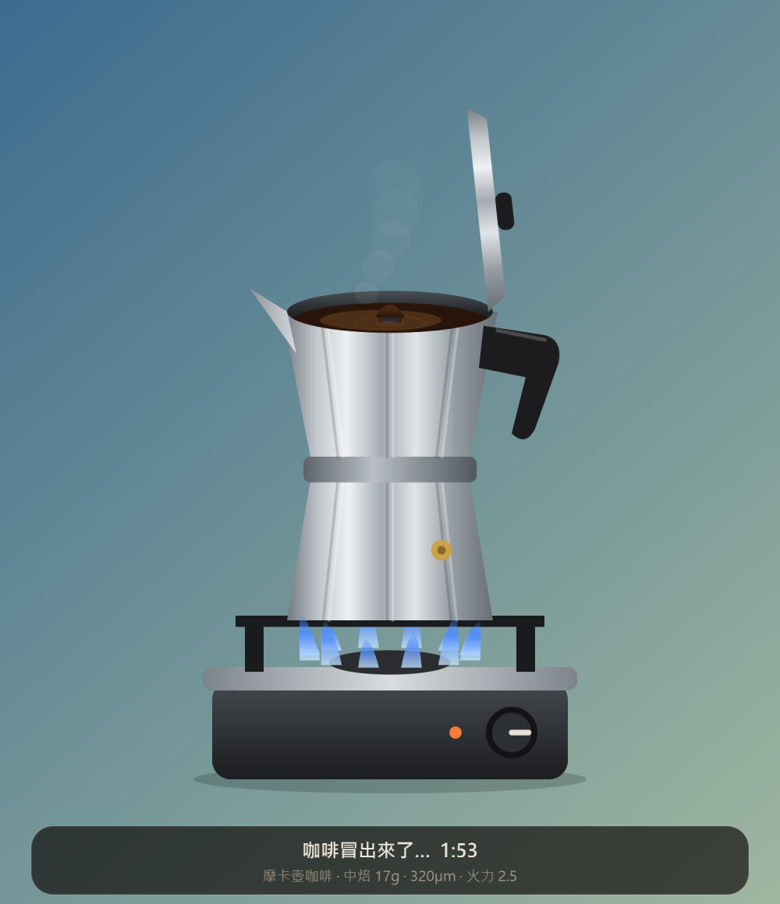<br><b>摩卡壺</b><br>小瓦斯爐點火，咖啡從中柱咕嚕咕嚕冒出來；火力越大火焰越大，太大會焦苦</td>
    <td width="33%" align="center" valign="top">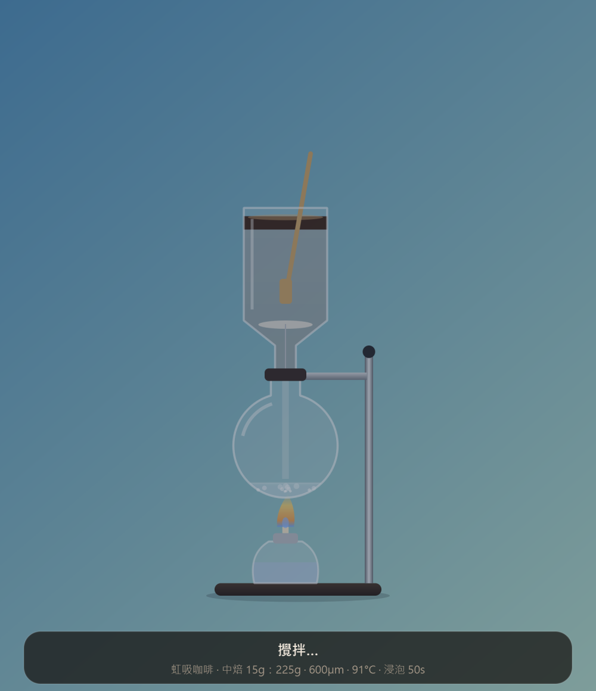<br><b>虹吸壺</b><br>酒精燈把水推上上壺，下粉、竹棒攪拌、浸泡；熄火後咖啡被吸回下壺</td>
    <td width="33%" align="center" valign="top">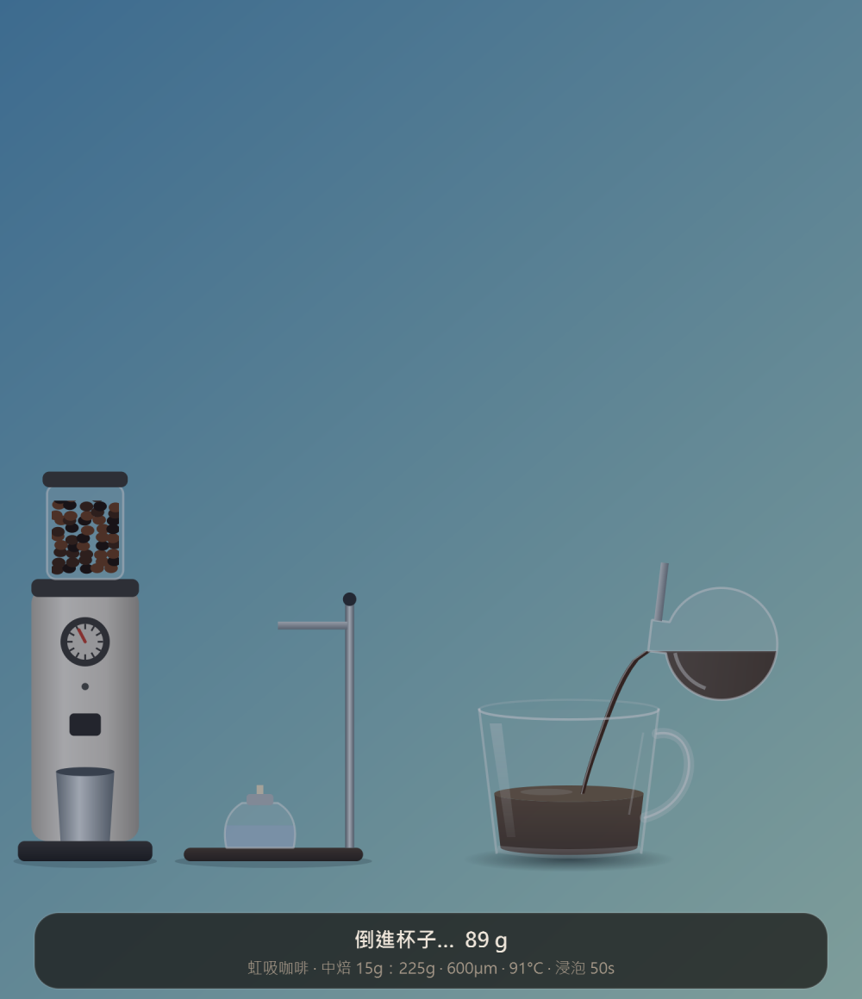<br><b>倒進杯子</b><br>拿掉上壺，從下壺倒進杯子；液面保持水平，越倒越空傾斜得越多</td>
  </tr>
</table>

右鍵「沖煮方式」切換義式咖啡機、手沖、冰滴、摩卡壺、虹吸壺；「飲品」選單只列出這個方式能做的飲品。

### 營業模式

<table width="100%">
  <tr>
    <td width="50%" align="center" valign="top"><br><b>出杯台</b><br>營業用雙頭機兩杯一起做：濃縮先萃取到量杯，再到出杯台倒進杯子</td>
    <td width="50%" align="center" valign="top">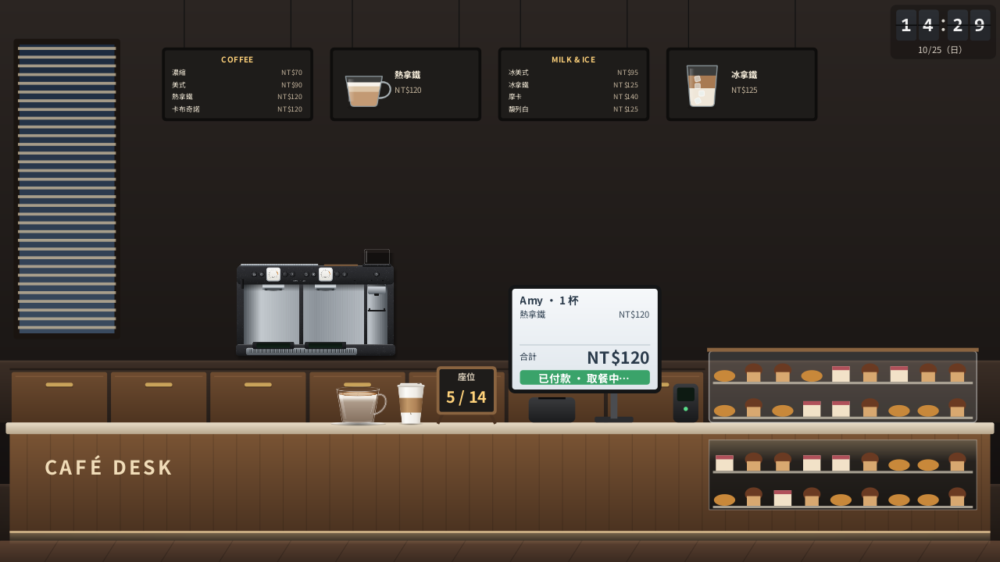<br><b>櫃檯</b><br>做好的杯子放上櫃檯，客人拿走後 POS 才顯示評分；小黑板是目前的座位</td>
  </tr>
</table>

右鍵選單上方的模式選「營業」（另外兩個是「手動」「自動」，三選一）：客人隨時上門排隊（最多 4 位，店鋪升級後 5–6 位），點單紙後面疊著排隊的訂單，下面一排計時圈是每位客人剩下的耐心（綠 → 橘 → 紅，快走時會閃）。
咖啡師接單時先到櫃檯讓客人在 POS 刷卡付錢（付了錢的客人不會走掉），再自動換到那台咖啡機或沖煮方式做；做好後到櫃檯交給客人，客人拿到飲品才評分、給小費。沒有客人時畫面停在櫃檯。

- **店面**：百葉窗、吊掛菜單看板（今日熱賣前三）、後檯擺營業用的咖啡機、整排木質櫃檯與甜點玻璃櫃；POS 大螢幕顯示品項、合計、付款與評分。
- **內用／外帶**：內用用玻璃杯（放杯盤），外帶熱飲用紙杯、冰飲用塑膠杯，一律蓋好蓋子。
- **大中小杯**：加奶／加水的飲品分大中小，杯子跟著縮放，紙杯印 S／M／L；每種飲品約裝到九成滿。
- **一張單好幾杯**：有些客人一次點 2–3 杯，先做好的放出餐架，全部好了才一起交付。
- **座位**：依店鋪等級 4–16 位，坐滿了新客人只能外帶；櫃檯的小黑板寫目前坐著幾位。
- **營業用雙頭機**（Lv.9）：兩個沖煮頭，萃取的同時打奶，排隊裡有同一類飲品就兩杯一起做；紀錄與收集冊「店鋪」頁可以指定營業用哪一台咖啡機。
- **翻頁鐘**：營業時右上角的翻頁鐘與日期，右鍵可以調整或隱藏。

- **店鋪等級 Lv.1–10**：依累積營業額升級（路邊小攤 → 夢想咖啡館），等級越高客人越多、越有耐心，出杯也更快。
- **咖啡師稱號**：做越多杯越熟練（新手 → 大師），打奶、研磨、拉花的手感誤差越小；稱號越高，能做的飲品越多，升到「職人」後萃取的同時打奶。
- **打烊日報**：關掉營業模式或跨過午夜時，滑出一張收據：服務人數、營業額、最佳一杯、跟上一個營業日比較、升級進度。
- **設備解鎖**：一開始只有 DESK·01 與義式，店鋪升級後陸續解鎖手沖、其他咖啡機、摩卡壺、冰滴與虹吸壺。
- **商店**：用賺到的營業額買咖啡機與磨豆機升級（PID 溫控、精密刀盤、專業奶泡機、平刀盤、鬼齒刀盤…）和精品咖啡豆（藝妓、藍山、可娜），營業中也能買；花錢不會掉級。
- **圖鑑**：紀錄與收集冊的「圖鑑」頁有每種飲品與設備的圖，還沒做過或沒解鎖的是剪影；「說明」頁寫各模式的差別與解鎖條件。
- 營業時參數由咖啡師自己調，結束營業後還原你原本的咖啡機、飲品與參數；播放速度只影響手動與自動模式。

## 下載（Windows）

到 [Releases](https://github.com/DeanLin0720/Cafe-Desk/releases/latest) 下載 `CafeDesk-vX.Y.Z-win64.7z`，解壓後執行 `CafeDesk.exe`，不需要安裝 Python。
發佈檔由 GitHub Actions 從原始碼公開建置，可以用 `gh attestation verify <檔名> --repo DeanLin0720/Cafe-Desk` 確認檔案來自這個倉庫的建置，SHA256 附在同一個 Release。

## 從原始碼執行

開發與測試環境：Windows 11、Python 3.14、PySide6 6.12。

```
pip install PySide6
pythonw main.py
```

Windows 用 `pythonw` 不會多開一個主控台視窗；要看錯誤訊息時改用 `python`。

## 操作

| 動作 | 說明 |
|---|---|
| 左鍵點咖啡機或磨豆機 | 開始沖煮（手沖、冰滴、摩卡壺、虹吸壺的畫面點任何地方） |
| 滑鼠停在機身上 | 顯示萃取曲線卡片（拿鐵類會同時顯示拉花）；透明擺件時狀態列也是這時才出現 |
| 左鍵拖曳 | 移動位置（會記住） |
| 右鍵 | 選單：沖煮方式、咖啡機、飲品、拉花圖案、參數設定、豆子、清潔保養、紀錄與收集冊、模式（手動／自動／營業）、自動間隔、休息提醒、聲音（音量、環境音）、音樂、視窗化顯示、大小、Language、更新、關於… |
| 系統匣圖示 | 單擊叫回咖啡機；右鍵有沖煮、模式（手動／自動／營業）、音樂、結束 |

| 模式 | 說明 |
|---|---|
| 手動 | 點沖煮設備做目前選的飲品 |
| 自動 | 每隔設定的間隔，照目前的飲品與參數再做一杯（豆子用完自己開新包、該清潔時自己清） |
| 營業 | 客人隨機點、排隊、有耐心，咖啡師自己接單；營業時沖煮方式、咖啡機、飲品等選單鎖住 |

| 陪伴功能 | 說明 |
|---|---|
| 環境音 | 下雨天的咖啡廳（人聲、吧台、杯盤、窗外雨聲），或森林雨聲（偶爾遠雷）；三段音量，在右鍵「聲音」子選單，跟著「開啟聲音」 |
| 音樂 | 右鍵「音樂」：加入自己的音檔或資料夾（mp3、m4a、flac、ogg、wav），播放清單、依序／隨機／單曲循環、三段音量；縮到系統匣時繼續播 |
| 休息提醒 | 每 25／45／60 分鐘或自訂間隔提醒休息，咖啡師順便做一杯 |
| 檢查更新 | 每天查一次 GitHub Releases，有新版時右鍵選單最上面出現「下載新版」；可在「更新」關閉 |

同一份設定檔只會有一個 Café Desk 在跑，再開一次會把原本那台叫出來。完整的功能說明在 `main.py` 開頭。

## 資料檔

都放在程式旁（打包後是 `CafeDesk.exe` 旁），資料夾無法寫入時改放使用者資料夾。右鍵「關於 Café Desk…」可以看到位置並開啟資料夾。

| 檔案 | 內容 |
|---|---|
| `cafe_desk.json` | 設定（刪除即恢復預設） |
| `cafe_desk_records.db` | 每杯紀錄、成就與商店購買（SQLite，每筆有簽章）；「關於」視窗的「重新遊玩」會清除它 |
| `cafe_desk.log` | 錯誤紀錄（回報問題時請附上） |
| `sound/` | 第一次執行時合成的音效；環境音第一次選用時才合成 |

唯一的網路連線是檢查更新：每天一次查詢 GitHub Releases 的最新版本號，不送出任何個人資料；右鍵「更新」可以關閉。

## 打包（Windows）

```
pip install pyinstaller
pyinstaller --noconfirm CafeDesk.spec
```

輸出在 `dist/CafeDesk/`，整個資料夾一起發佈，執行 `CafeDesk.exe`。

## 開發

```
pip install pytest
python -m pytest
```

測試在無頭模式執行，不會開視窗也不會出聲。`tools/` 裡有壓力測試、各階段截圖、畫面回歸比對等工具。
版本變更見 `CHANGELOG.md`。推 `v*` tag 會由 GitHub Actions 測試、打包並發佈 Release（`.github/workflows/release.yml`）。

## 授權

[MIT License](LICENSE) © 2026 DeanLin

---

<a id="english"></a>

# Café Desk

[繁體中文](#café-desk-桌上咖啡吧) ｜ **English**

A coffee machine desktop toy. A window holds an espresso machine, a grinder and assorted gear (a normal window by default; untick "Windowed" in the right-click menu to make it a transparent, borderless toy standing on your desktop). Click once and it makes a coffee with animation and synthesized sound effects, then gives you a simple score.

- Five brew methods, each with its own scene: espresso machine, pour-over, cold drip, moka pot and siphon (cold drip takes about an hour, measured from the time the tower was set up; nothing runs while the app is closed, and on the next launch the progress is worked out from the elapsed time)
- Five machines (DESK·01 dual-gauge steel machine, vintage lever machine, compact single-boiler machine, all-in-one with built-in grinder, two-group café machine), each with traits that affect extraction
- 16 espresso drinks including espresso, americano, latte, cappuccino, flat white, mocha, caramel macchiato, espresso tonic and affogato, plus pour-over, cold drip, moka pot and siphon, and 3 seasonal specials during festivals
- Full prep workflow (take the portafilter → knock out → grind → distribute → tamp → lock in), milk steaming and latte art, beans and rest days, cleaning and maintenance (tracked per machine)
- Three modes: manual, auto (keeps brewing your current drink with your current settings) and business (customers order and pay, queue up and run out of patience, and rate the drink once they pick it up at the counter)
- Business mode: a pass counter and a shop counter, POS checkout, for here / to go, small / medium / large cups, multi-drink orders, seats and a flip clock
- Business mode progression: shop level 1–10, barista titles (an Artisan steams milk while the shot pulls) and a closing report; spend your revenue in the store on equipment upgrades and specialty beans, and unlock gear and drinks as you level up
- Extras: ambience (a rainy-day café, forest rain with distant thunder), your own music, break reminders, a daily update check
- Simple physics: liquid stays level while pouring and the vessel tips further as it empties, vessels go over the cup instead of through it, pour-over drips accelerate and a thin stream breaks into drops
- Records and collection: daily records, 61 achievements (tiered sets in bronze / silver / gold, counting only cups made for customers), a drink and equipment book (with latte art), and a game guide
- A 16:9 window (1920×1080, 1600×900, 1280×720, 960×540); paper-style menus and windows; 繁體中文 / English (prices show in NT$ or US$ to match the language)

<p align="center">
  
</p>

## Screenshots

### Making a latte

<table width="100%">
  <tr>
    <td width="33%" align="center" valign="top"><br><b>Brew</b><br>Espresso flows into the cup, the scale shows weight and time</td>
    <td width="33%" align="center" valign="top"><br><b>Steam</b><br>The steam wand heats the milk, temperature and foam amount shape the art</td>
    <td width="33%" align="center" valign="top"><br><b>Pour</b><br>Pouring milk, the art card shows the pattern live</td>
  </tr>
</table>

When a drink is done, the status bar shows stars, a score and a comment. Hover over the machine to see the extraction curve and latte art cards.

### Four machines

<table width="100%">
  <tr>
    <td width="50%" align="center" valign="top"><br><b>DESK·01 dual-gauge steel machine</b></td>
    <td width="50%" align="center" valign="top"><br><b>Vintage lever machine</b></td>
  </tr>
  <tr>
    <td width="50%" align="center" valign="top"><br><b>Compact single-boiler machine</b></td>
    <td width="50%" align="center" valign="top"><br><b>All-in-one with built-in grinder</b></td>
  </tr>
</table>

### Pour-over and cold drip

<table width="100%">
  <tr>
    <td width="33%" align="center" valign="top">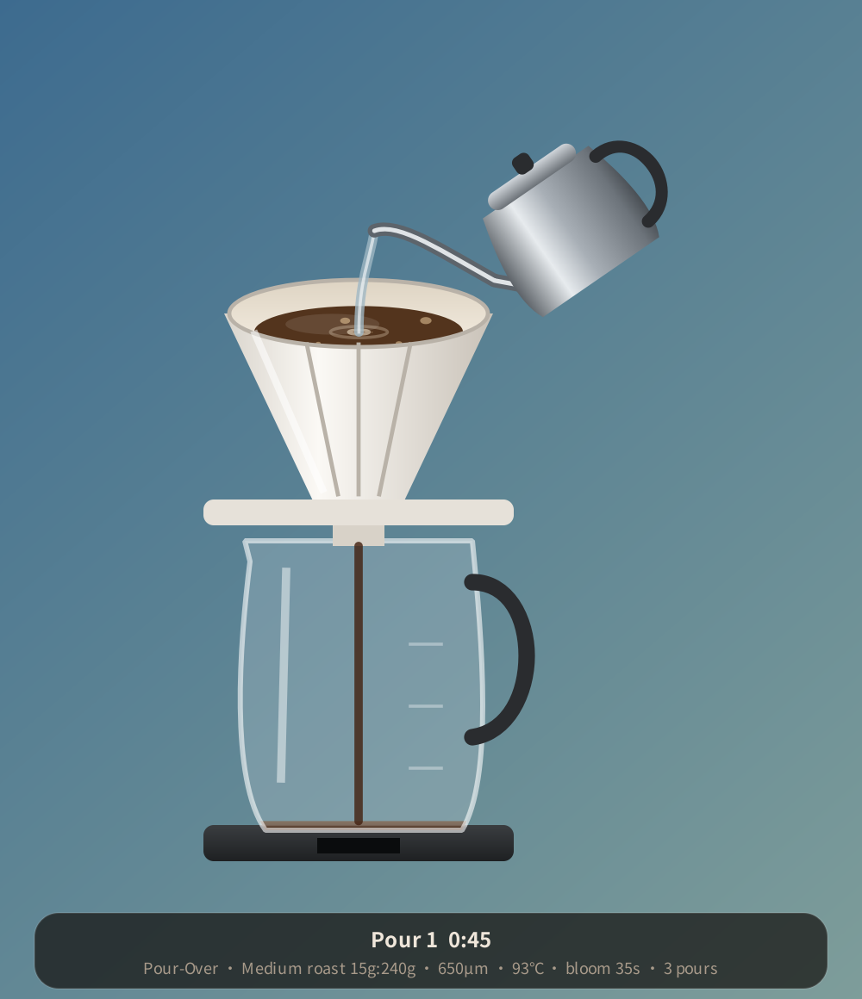<br><b>Pour-over</b><br>The view zooms in while brewing: bloom, pulse pours, drawdown</td>
    <td width="33%" align="center" valign="top">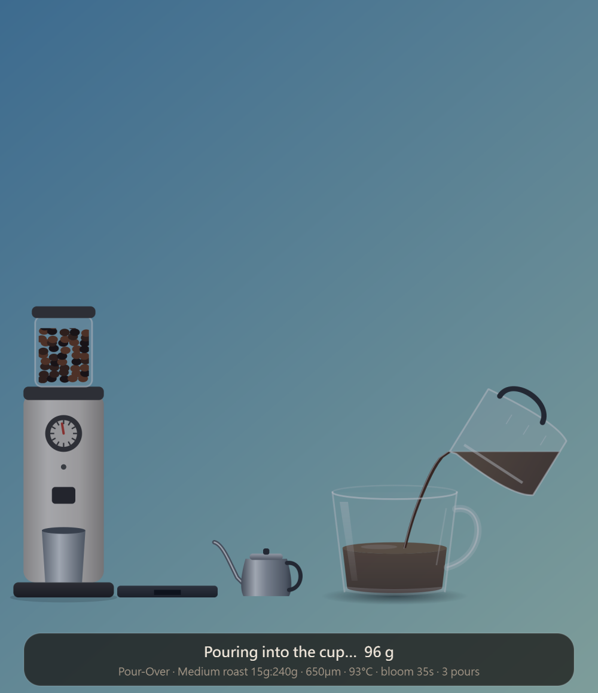<br><b>Serve</b><br>It zooms back out and pours the server into the cup; the pour-over grinder is on the left</td>
    <td width="33%" align="center" valign="top">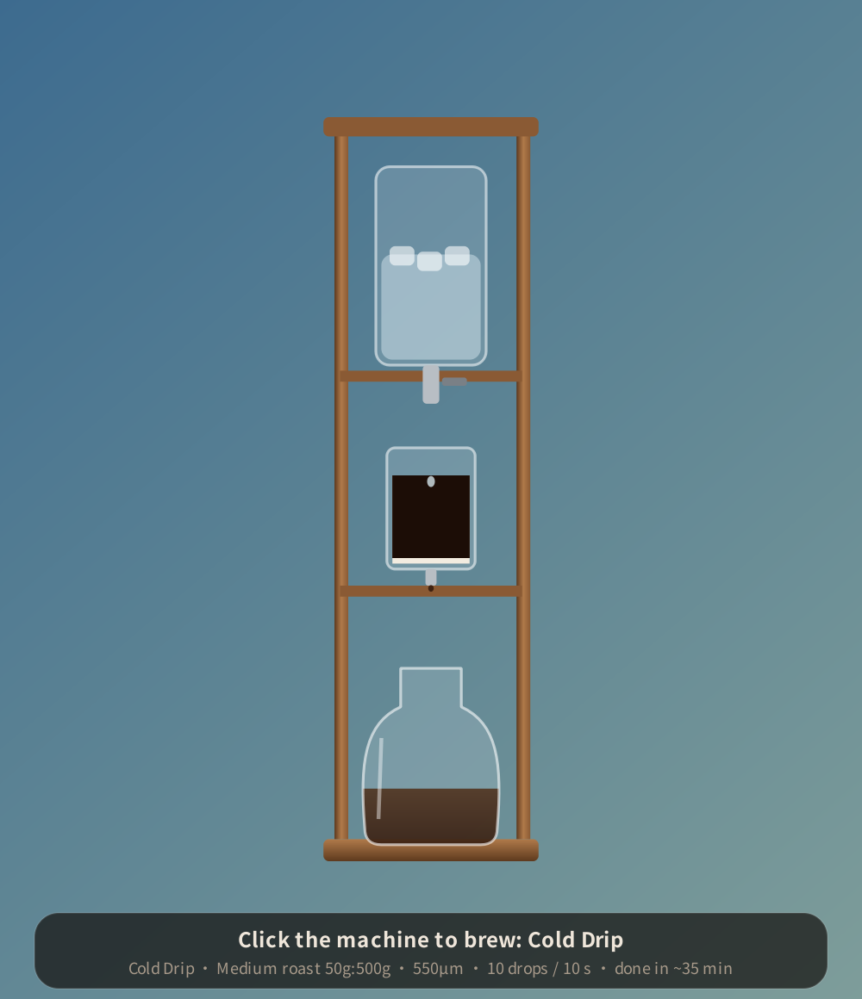<br><b>Cold drip</b><br>Takes about an hour of elapsed clock time (time keeps counting while the app is closed), then makes 4 cups</td>
  </tr>
</table>

### Moka pot and siphon

<table width="100%">
  <tr>
    <td width="33%" align="center" valign="top">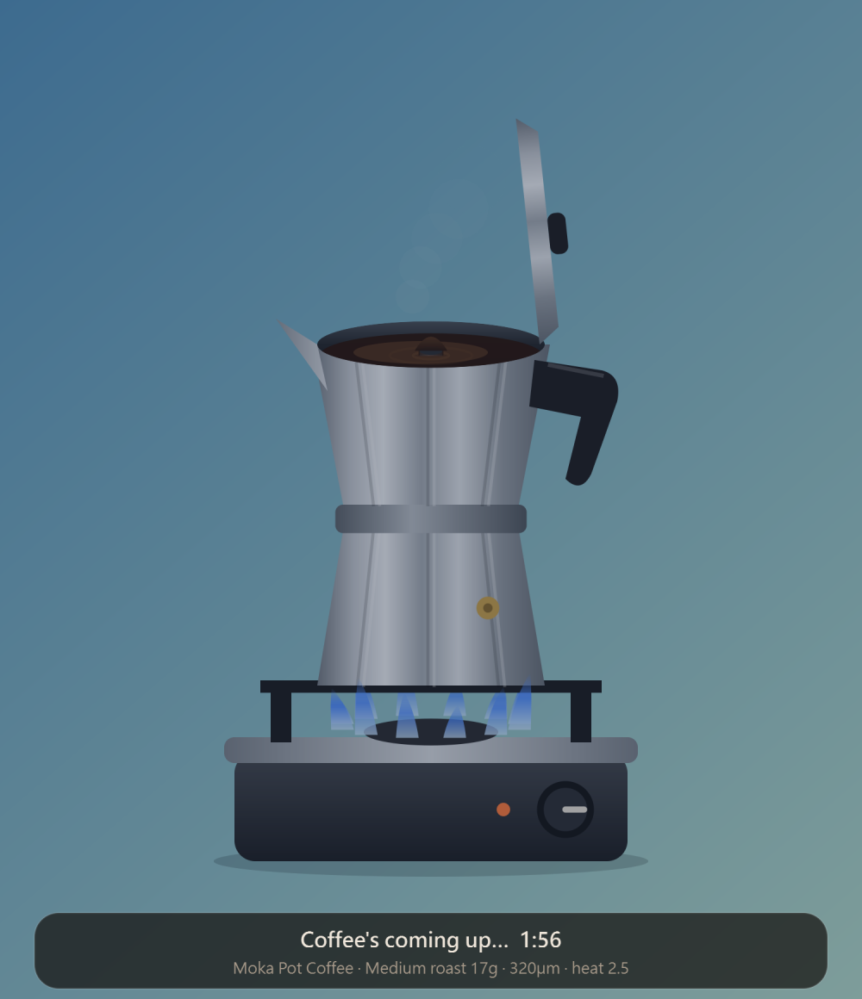<br><b>Moka pot</b><br>On a small gas stove, coffee gurgles up through the center column; more heat means a bigger flame, and too much tastes scorched</td>
    <td width="33%" align="center" valign="top">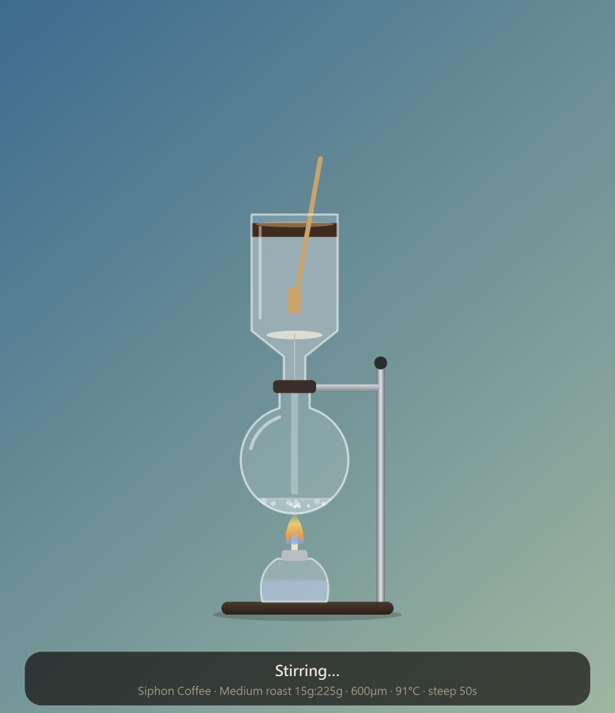<br><b>Siphon</b><br>An alcohol lamp pushes the water into the top chamber; add the grounds, stir with a bamboo paddle and steep, then the coffee is drawn back down when the flame goes out</td>
    <td width="33%" align="center" valign="top">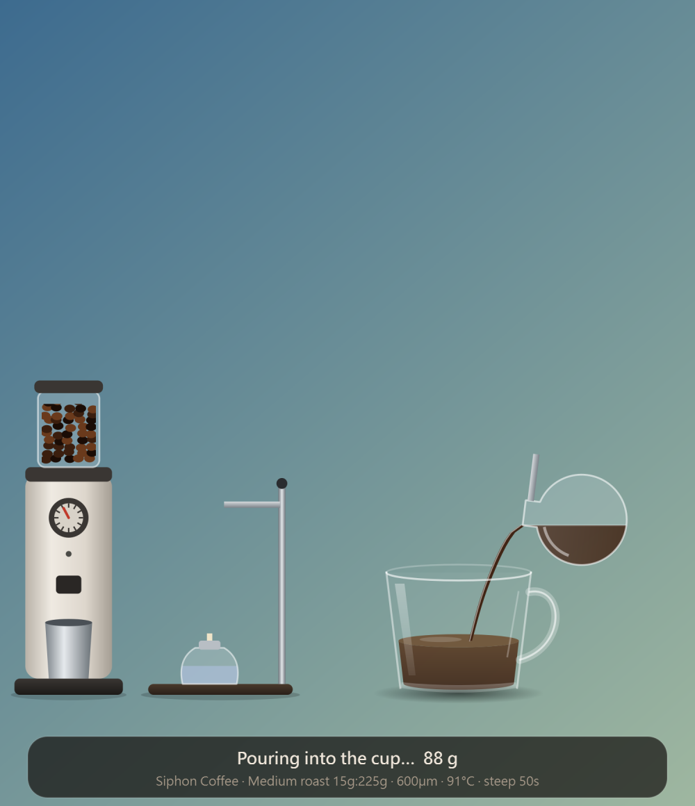<br><b>Serve</b><br>The top chamber comes off and the bottom globe pours into the cup; the liquid stays level and the globe tips further as it empties</td>
  </tr>
</table>

Use "Brew Method" in the right-click menu to switch between the espresso machine, pour-over, cold drip, moka pot and siphon; the drinks menu lists only what that method can make.

### Business mode

<table width="100%">
  <tr>
    <td width="50%" align="center" valign="top">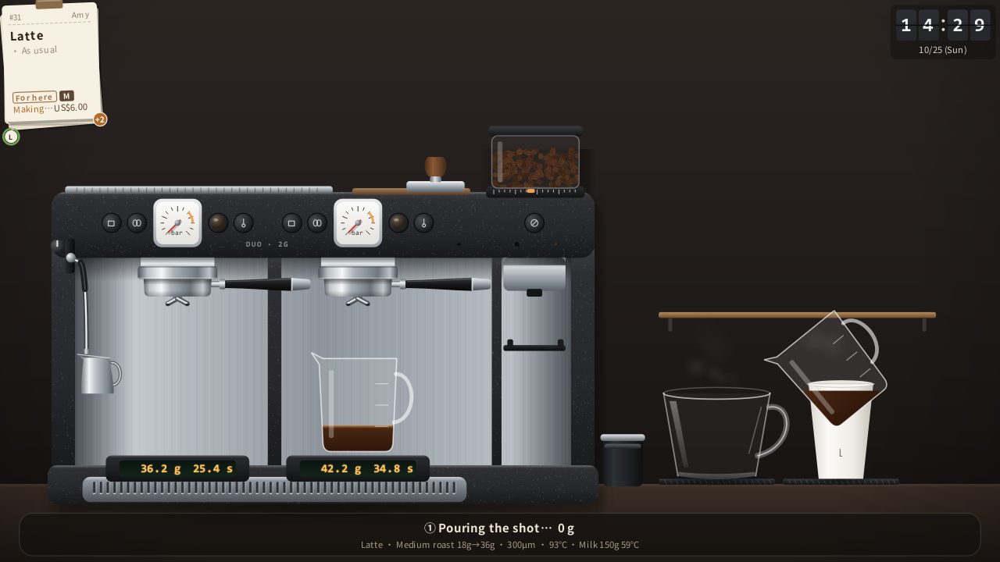<br><b>Pass counter</b><br>The two-group machine makes two drinks at once: the shot goes into a shot glass, then into the cup on the pass counter</td>
    <td width="50%" align="center" valign="top">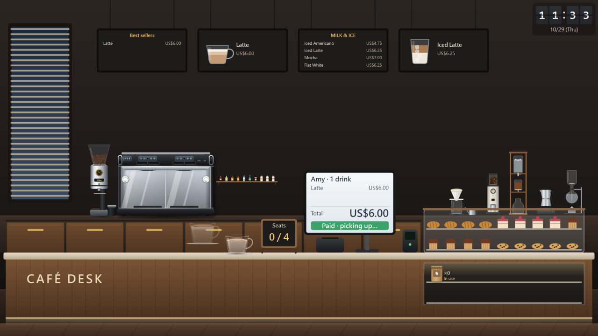<br><b>Counter</b><br>Finished drinks go on the counter, and the POS shows the rating once the customer picks them up; the chalkboard shows the seats</td>
  </tr>
</table>

Pick "Business" in the mode choice at the top of the right-click menu (the other two are "Manual" and "Auto"): customers keep arriving and queue up (up to 4, or 5–6 at higher shop levels), queued orders stack behind the slip, and a row of timer rings below it shows each customer's remaining patience (green → orange → red, blinking when they're about to leave).
When the barista takes an order, the customer pays at the POS first (customers who have paid don't walk out), then the barista switches to the machine or brew method the drink needs. Finished drinks are handed over at the counter, and the customer rates the drink and tips once they pick it up. With no customers waiting, the view stays on the counter.

- **The shop**: blinds, hanging menu boards (today's top three), the shop machine on the back counter, a long wooden counter and a pastry case; the POS screen shows items, the total, payment and the rating.
- **For here / to go**: glass cups (on a saucer) for here; paper cups for hot drinks and plastic cups for iced drinks to go, always with a lid.
- **Cup sizes**: drinks with milk or water come in small, medium and large, the cup scales to match and paper cups are marked S / M / L; every drink fills its cup to about 90%.
- **Multi-drink orders**: some customers order 2–3 drinks; finished ones wait on the pass shelf and are handed over together.
- **Seats**: 4–16 depending on shop level; when they're full, new customers can only take away. The chalkboard on the counter shows how many are seated.
- **Two-group café machine** (Lv.9): steams milk while the shot pulls and makes two drinks at once when the queue has a matching order; the Shop tab of the records window lets you pick which machine to use for business.
- **Flip clock**: a flip clock with the date in the top right during business; adjust or hide it from the right-click menu.

- **Shop level 1–10**: grows with total revenue (Street Stall → Dream Café); higher levels bring more, and more patient, customers, and drinks come out faster.
- **Barista titles**: the more cups made, the steadier the hands (Rookie → Master), with smaller errors in milk, grind and latte art; higher titles unlock more drinks, and an Artisan steams milk while the shot pulls.
- **Closing report**: when business mode ends or the day rolls over, a receipt slides up with customers served, revenue, best cup, comparison with the last business day and level progress.
- **Equipment unlocks**: you start with DESK·01 and espresso only; leveling up the shop unlocks pour-over, the other machines, moka pot, cold drip and siphon.
- **Store**: spend your revenue on machine and grinder upgrades (PID kit, precision burrs, pro frother, flat burrs, ghost-tooth burrs…) and specialty beans (Geisha, Blue Mountain, Kona), even during business; spending never lowers your shop level.
- **Collection book**: the Collection tab of the records window pictures every drink and piece of equipment, with silhouettes for what you haven't made or unlocked yet; the Guide tab explains the modes and unlocks.
- The barista sets the parameters during business, and your own machine, drink and settings come back when business ends; playback speed only applies in manual and auto modes.

## Download (Windows)

Get `CafeDesk-vX.Y.Z-win64.7z` from [Releases](https://github.com/DeanLin0720/Cafe-Desk/releases/latest), extract it and run `CafeDesk.exe`. No Python needed.
Release files are built publicly from source by GitHub Actions. `gh attestation verify <file> --repo DeanLin0720/Cafe-Desk` confirms a file came from this repository's build, and the SHA256 is attached to the same Release.

## Run from source

Developed and tested on Windows 11, Python 3.14, PySide6 6.12.

```
pip install PySide6
pythonw main.py
```

On Windows, `pythonw` avoids opening an extra console window, use `python` when you need to see error messages.

## Controls

| Action | What it does |
|---|---|
| Left-click the machine or grinder | Start brewing (anywhere in the pour-over, cold drip, moka pot and siphon scenes) |
| Hover over the machine | Show the extraction curve card (with latte art for milk drinks); in transparent mode the status bar also appears only then |
| Left-drag | Move the window (position is remembered) |
| Right-click | Menu: brew method, machine, drinks, latte art, settings, beans, cleaning, records and collection, mode (manual / auto / business), auto interval, break reminder, sound (volume, ambience), music, windowed, size, Language, updates, About… |
| Tray icon | Click to bring the machine back, right-click for brew, mode (manual / auto / business), music, quit |

| Mode | What it does |
|---|---|
| Manual | Click the brewer to make the selected drink |
| Auto | Makes the selected drink again with your settings at the chosen interval (opens a new bag and cleans when needed) |
| Business | Random orders, a queue and patience, the barista takes orders itself; brew method, machine, drink and similar menus are locked while it runs |

| Extra | What it does |
|---|---|
| Ambience | Rainy-day café (chatter, the bar, cups, rain outside), or forest rain with distant thunder; three volume levels, in the right-click Sound submenu (follows "Sound on") |
| Music | Right-click › Music: add your own files or a folder (mp3, m4a, flac, ogg, wav); playlist, repeat all / shuffle / repeat one, three volume levels; keeps playing when hidden to the tray |
| Break reminder | Reminds you to take a break every 25/45/60 minutes or a custom interval, and the barista makes a cup |
| Updates | Checks GitHub Releases once a day; when a new version is out, "Download" appears at the top of the right-click menu. Can be turned off under Updates |

Only one Café Desk runs per config file, launching it again brings the running one to the front. A full feature description is at the top of `main.py`.

## Data files

Stored next to the program (next to `CafeDesk.exe` when packaged), or in the user folder if that folder is not writable. Right-click "About Café Desk…" to see the location and open the folder.

| File | Contents |
|---|---|
| `cafe_desk.json` | Settings (delete to reset to defaults) |
| `cafe_desk_records.db` | Per-cup records, achievements and store purchases (SQLite, each row signed); "Start over" in the About window clears it |
| `cafe_desk.log` | Error log (please attach it when reporting issues) |
| `sound/` | Sound effects synthesized on first run; ambience is synthesized the first time you pick it |

The only network access is the update check: once a day it asks GitHub Releases for the latest version number and sends no personal data. Turn it off under Updates in the right-click menu.

## Packaging (Windows)

```
pip install pyinstaller
pyinstaller --noconfirm CafeDesk.spec
```

The output is in `dist/CafeDesk/`. Distribute the whole folder and run `CafeDesk.exe`.

## Development

```
pip install pytest
python -m pytest
```

Tests run headless: no windows, no sound. `tools/` has stress tests, per-stage screenshots and render regression tools.
See `CHANGELOG.md` for version changes. Pushing a `v*` tag makes GitHub Actions test, package and publish a Release (`.github/workflows/release.yml`).

## License

[MIT License](LICENSE) © 2026 DeanLin
