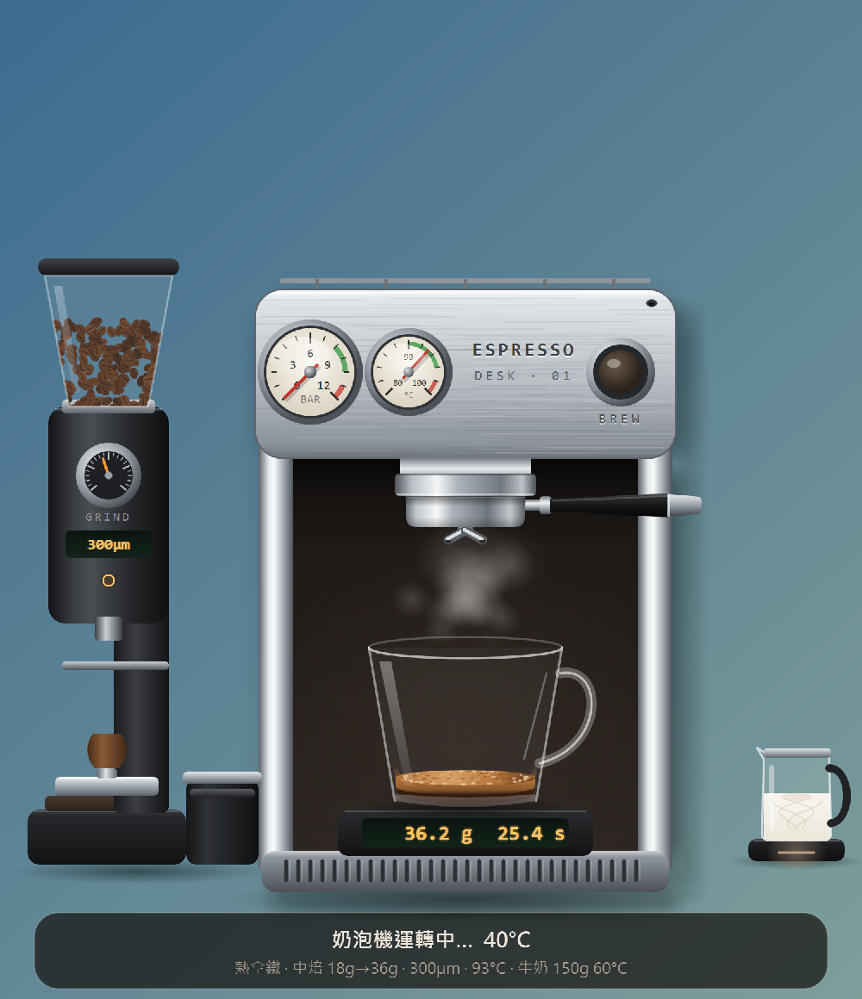
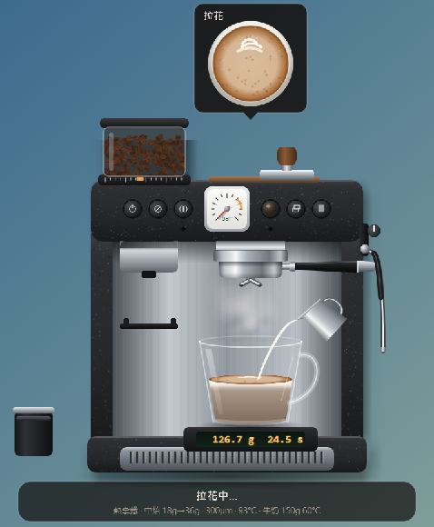
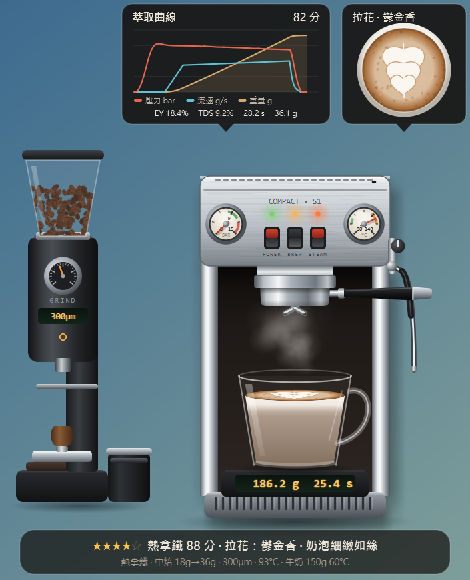
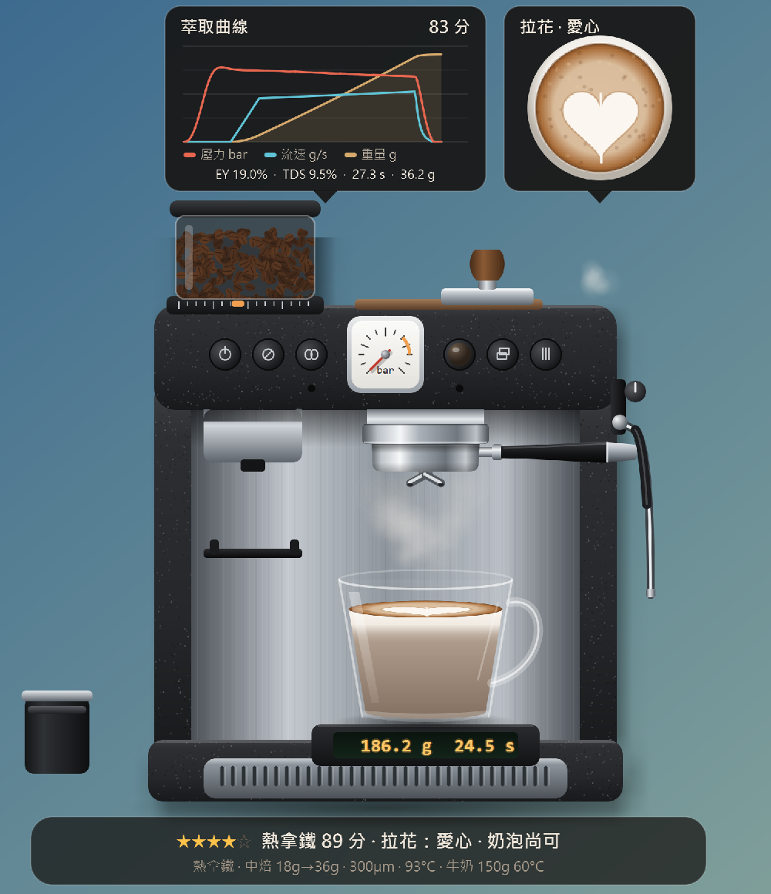
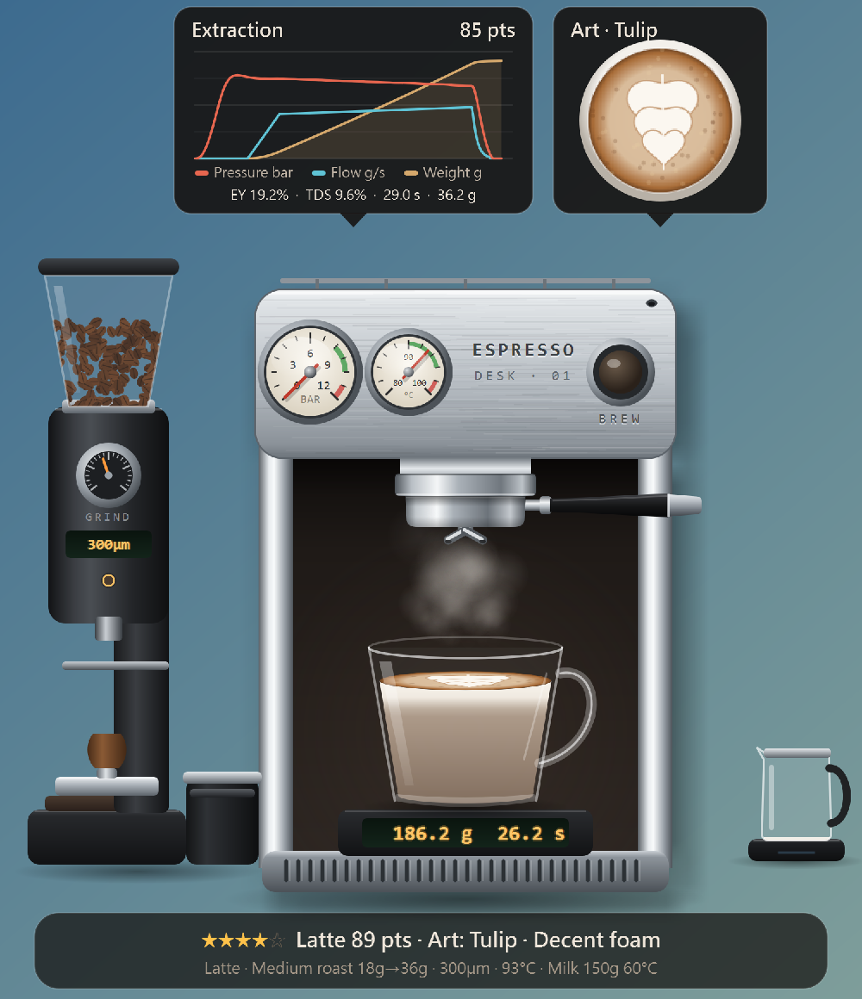
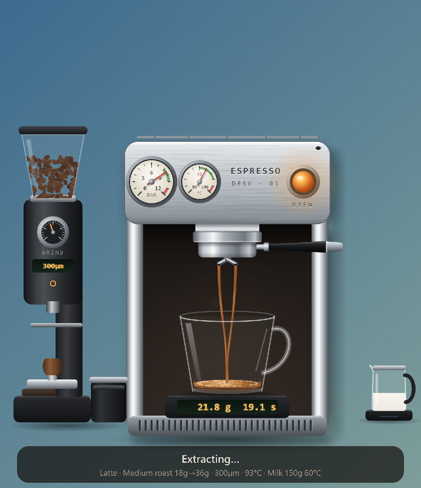
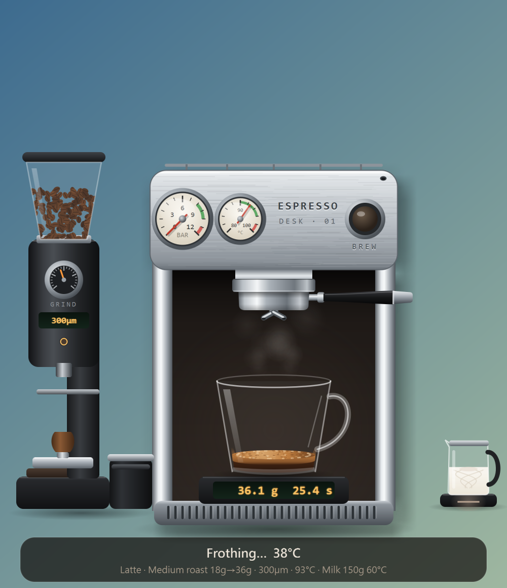
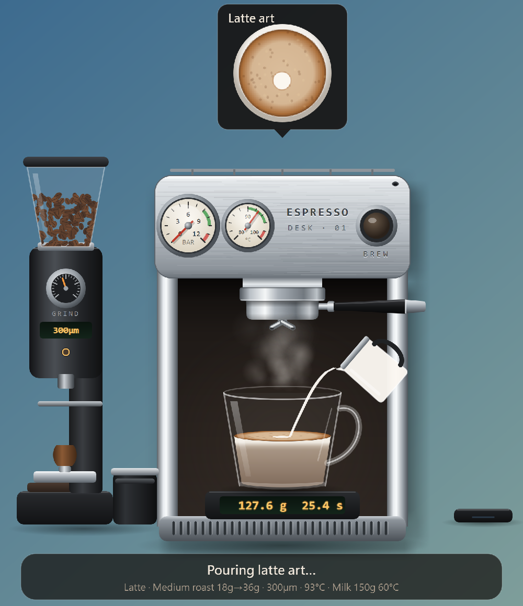
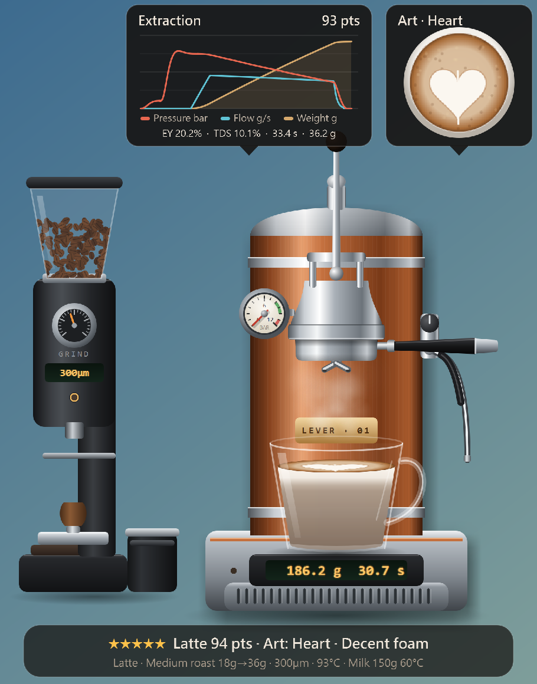
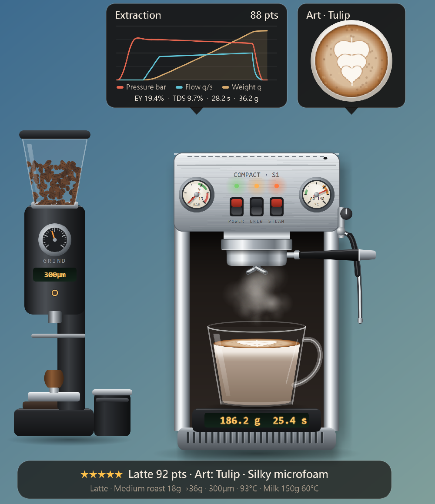

# Café Desk 桌上咖啡吧

**繁體中文** ｜ [English](#english)

放在桌面上的咖啡機擺件。透明無邊框的視窗裡站著咖啡機、磨豆機和各種器具，點一下就用動畫和合成音效做一杯咖啡，最後給一個簡單的分數。

- 四台咖啡機（DESK·01 雙錶不鏽鋼機、復古拉桿機、小型單鍋爐機、內建磨豆的一體機），各有特性影響萃取
- 濃縮、美式、拿鐵、卡布奇諾、馥列白、摩卡、焦糖瑪奇朵、濃縮通寧、阿芙佳朵等 16 種飲品，節日期間另有 3 款季節限定
- 完整備粉流程（取把手 → 敲渣 → 磨豆 → 布粉 → 填壓 → 扣回）、打奶與拉花、顧客點單、豆子與養豆天數、清潔保養
- 每日紀錄、17 個成就、拉花收集冊
- 繁體中文／English

<p align="center">
  
</p>

## 畫面

### 一杯拿鐵的過程

<table width="100%">
  <tr>
    <td width="33%" align="center" valign="top"><br><b>萃取</b><br>咖啡液流進杯中，磅秤顯示重量與時間</td>
    <td width="33%" align="center" valign="top"><br><b>打奶</b><br>蒸汽管打奶，溫度與奶泡量影響拉花</td>
    <td width="33%" align="center" valign="top"><br><b>拉花</b><br>傾倒牛奶，拉花卡片即時顯示圖案</td>
  </tr>
</table>

做完後狀態列給星等、分數與評語；滑鼠停在機身上會顯示萃取曲線與拉花卡片。

### 四台咖啡機

<table width="100%">
  <tr>
    <td width="50%" align="center" valign="top"><br><b>DESK·01 雙錶不鏽鋼機</b></td>
    <td width="50%" align="center" valign="top"><br><b>復古拉桿機</b></td>
  </tr>
  <tr>
    <td width="50%" align="center" valign="top"><br><b>小型單鍋爐機</b></td>
    <td width="50%" align="center" valign="top"><br><b>內建磨豆的一體機</b></td>
  </tr>
</table>

## 安裝與執行

開發與測試環境：Windows 11、Python 3.14、PySide6 6.12。

```
pip install PySide6
pythonw main.py
```

Windows 用 `pythonw` 不會多開一個主控台視窗；要看錯誤訊息時改用 `python`。

## 操作

| 動作 | 說明 |
|---|---|
| 左鍵點咖啡機或磨豆機 | 開始沖煮 |
| 滑鼠停在機身上 | 顯示萃取曲線卡片（拿鐵類會同時顯示拉花） |
| 左鍵拖曳 | 移動位置（會記住） |
| 右鍵 | 選單：飲品、咖啡機、參數設定、豆子、清潔保養、紀錄與收集冊、自動模式、顧客點單、大小、Language、關於… |
| 系統匣圖示 | 單擊叫回咖啡機；右鍵有沖煮、自動模式、結束 |

同一份設定檔只會有一個 Café Desk 在跑，再開一次會把原本那台叫出來。完整的功能說明在 `main.py` 開頭。

## 資料檔

都放在程式旁（打包後是 `CafeDesk.exe` 旁），資料夾無法寫入時改放使用者資料夾。右鍵「關於 Café Desk…」可以看到位置並開啟資料夾。

| 檔案 | 內容 |
|---|---|
| `cafe_desk.json` | 設定（刪除即恢復預設） |
| `cafe_desk_records.db` | 每杯紀錄與成就（SQLite，每筆有簽章） |
| `cafe_desk.log` | 錯誤紀錄（回報問題時請附上） |
| `sound/` | 第一次執行時合成的音效 |

## 打包（Windows）

```
pip install pyinstaller
pyinstaller --noconfirm CafeDesk.spec
```

輸出在 `dist/CafeDesk/`，整個資料夾一起發佈，執行 `CafeDesk.exe`。

## 開發

```
pip install pytest
python -m pytest
```

測試在無頭模式執行，不會開視窗也不會出聲。`tools/` 裡有壓力測試、各階段截圖、畫面回歸比對等工具。
架構、慣例與注意事項見 `CLAUDE.md`，開發歷程與待辦見 `handoff.md`，版本變更見 `CHANGELOG.md`。

## 授權

[MIT License](LICENSE) © 2026 DeanLin

---

<a id="english"></a>

# Café Desk

[繁體中文](#café-desk-桌上咖啡吧) ｜ **English**

A coffee machine desktop toy. A transparent, borderless window holds an espresso machine, a grinder and assorted gear. Click once and it makes a coffee with animation and synthesized sound effects, then gives you a simple score.

- Four machines (DESK·01 dual-gauge steel machine, vintage lever machine, compact single-boiler machine, all-in-one with built-in grinder), each with traits that affect extraction
- 16 drinks including espresso, americano, latte, cappuccino, flat white, mocha, caramel macchiato, espresso tonic and affogato, plus 3 seasonal specials during festivals
- Full prep workflow (take the portafilter → knock out → grind → distribute → tamp → lock in), milk steaming and latte art, customer orders, beans and rest days, cleaning and maintenance
- Daily records, 17 achievements, a latte art collection
- 繁體中文 / English

<p align="center">
  
</p>

## Screenshots

### Making a latte

<table width="100%">
  <tr>
    <td width="33%" align="center" valign="top"><br><b>Brew</b><br>Espresso flows into the cup, the scale shows weight and time</td>
    <td width="33%" align="center" valign="top"><br><b>Steam</b><br>The steam wand heats the milk, temperature and foam amount shape the art</td>
    <td width="33%" align="center" valign="top"><br><b>Pour</b><br>Pouring milk, the art card shows the pattern live</td>
  </tr>
</table>

When a drink is done, the status bar shows stars, a score and a comment. Hover over the machine to see the extraction curve and latte art cards.

### Four machines

<table width="100%">
  <tr>
    <td width="50%" align="center" valign="top"><br><b>DESK·01 dual-gauge steel machine</b></td>
    <td width="50%" align="center" valign="top"><br><b>Vintage lever machine</b></td>
  </tr>
  <tr>
    <td width="50%" align="center" valign="top"><br><b>Compact single-boiler machine</b></td>
    <td width="50%" align="center" valign="top"><br><b>All-in-one with built-in grinder</b></td>
  </tr>
</table>

## Install and run

Developed and tested on Windows 11, Python 3.14, PySide6 6.12.

```
pip install PySide6
pythonw main.py
```

On Windows, `pythonw` avoids opening an extra console window, use `python` when you need to see error messages.

## Controls

| Action | What it does |
|---|---|
| Left-click the machine or grinder | Start brewing |
| Hover over the machine | Show the extraction curve card (with latte art for milk drinks) |
| Left-drag | Move the window (position is remembered) |
| Right-click | Menu: drinks, machine, settings, beans, cleaning, records and collection, auto mode, customer orders, size, Language, About… |
| Tray icon | Click to bring the machine back, right-click for brew, auto mode, quit |

Only one Café Desk runs per config file, launching it again brings the running one to the front. A full feature description is at the top of `main.py`.

## Data files

Stored next to the program (next to `CafeDesk.exe` when packaged), or in the user folder if that folder is not writable. Right-click "About Café Desk…" to see the location and open the folder.

| File | Contents |
|---|---|
| `cafe_desk.json` | Settings (delete to reset to defaults) |
| `cafe_desk_records.db` | Per-cup records and achievements (SQLite, each row signed) |
| `cafe_desk.log` | Error log (please attach it when reporting issues) |
| `sound/` | Sound effects synthesized on first run |

## Packaging (Windows)

```
pip install pyinstaller
pyinstaller --noconfirm CafeDesk.spec
```

The output is in `dist/CafeDesk/`. Distribute the whole folder and run `CafeDesk.exe`.

## Development

```
pip install pytest
python -m pytest
```

Tests run headless: no windows, no sound. `tools/` has stress tests, per-stage screenshots and render regression tools.
See `CLAUDE.md` for architecture and conventions, `handoff.md` for history and TODOs, and `CHANGELOG.md` for version changes.

## License

[MIT License](LICENSE) © 2026 DeanLin
